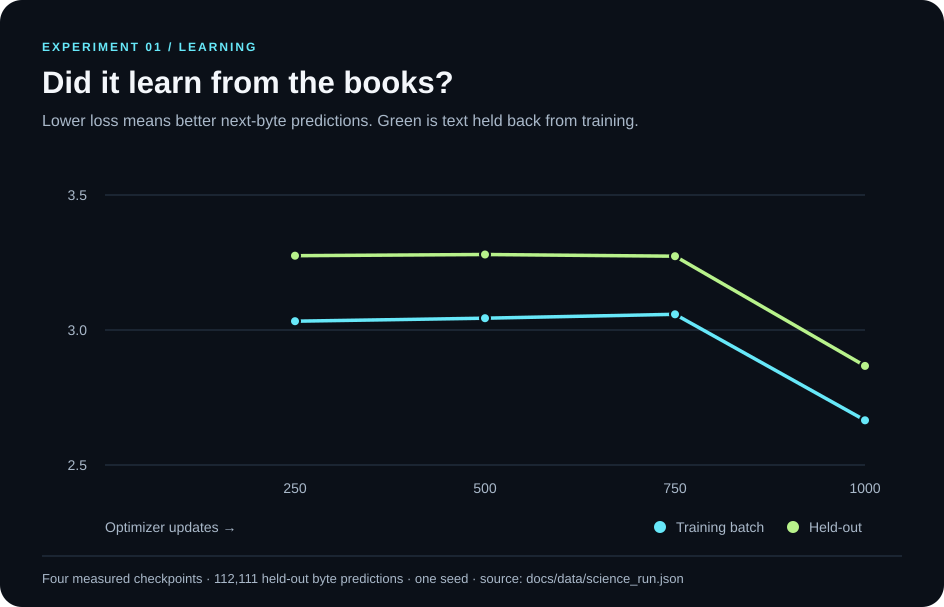
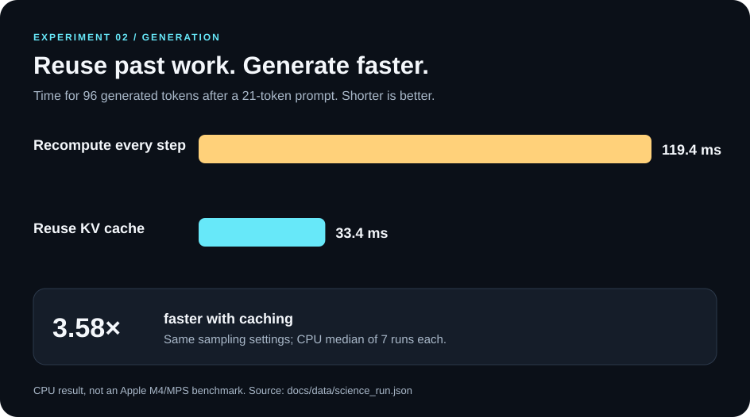
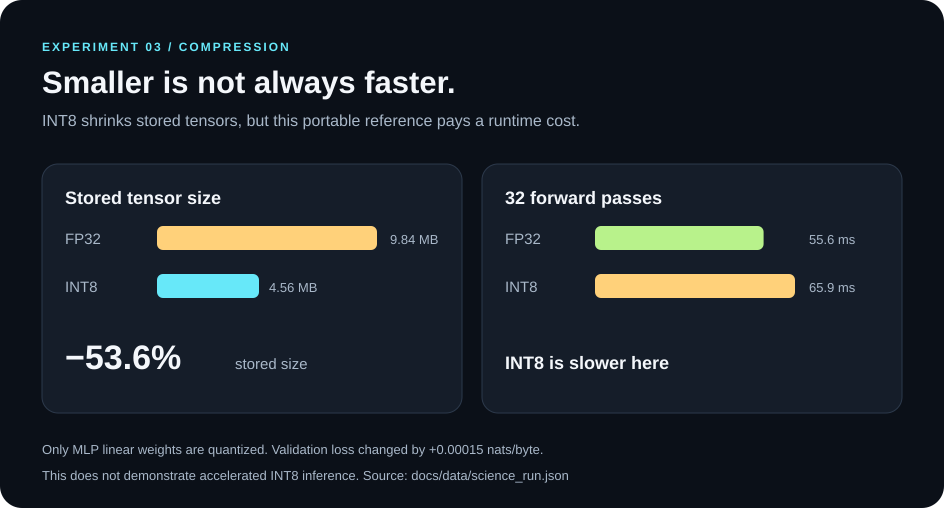

# MiniLM Lab

**Build a tiny language model. Measure what actually helps.**

Created and maintained by [Anvit Devadiga](https://github.com/AnvitDevadiga).

[](https://github.com/AnvitDevadiga/MiniLM-Lab/actions/workflows/ci.yml) [](https://www.python.org/) [](LICENSE)

MiniLM Lab is a small, inspectable language-model project. It follows the entire path from text to next-byte prediction, then tests whether engineering ideas—like reusing previous attention calculations or storing smaller weights—actually help. It is designed for a laptop budget, not to imitate a commercial chatbot.


### What did the experiment find?

The model trained on public-domain science writing by Darwin and Einstein. Paragraphs from **both** books were held out, so the numbers below are not training-set scores. [Sources and exact file hashes](data/science/manifest.json) · [Full experimental method](docs/experiment_protocol.md).



At the final checkpoint, held-out perplexity was **17.58** across **112,111 next-byte predictions**. Perplexity measures prediction uncertainty; lower is better, but it is not a score for how helpful or factual a chatbot is.



The KV cache avoids recomputing attention over the full prompt after every generated token. In this controlled CPU test, it cut generation time from **119.4 ms to 33.4 ms**.



Weight-only INT8 reduced stored model tensors by **53.6%**, but the reference implementation ran **slower** because it dequantizes weights during each forward pass. Smaller files do not automatically mean faster inference.

These are **one-seed CPU measurements**, not M4/MPS results or claims of general language ability. The training corpus is about **1 MB**. [Read the report, including limitations](docs/research_report.md) or inspect the [raw measured record](docs/data/science_run.json).

### Attention implementation and reproducibility study (October 2026)

The published run reproduces bit-for-bit on CPU. Retraining with seeds 42, 43 and 44 gives held-out perplexity **17.58, 18.99 and 21.07** (mean 19.21 ± 1.75). The published 17.58 is the best of the three, so read it as optimistic.

The same weights were run through three attention implementations: the default `nn.MultiheadAttention` path, PyTorch scaled-dot-product attention (SDPA), and an explicit reference. In float32 they give identical perplexity, top-1 predictions and greedy text on CPU and Apple M4 MPS. SDPA was 3.4–5.4× faster than the reference at 2,048 tokens and used 8–22× less memory. On CPU, the repository's default attention path is nearly as slow as the reference.


Trained with each backend on three seeds, the models are indistinguishable in quality, and SDPA training steps are 8–28% faster on CPU. SDPA is now a selectable training backend (`--attention-backend sdpa`). The evidence supports making it the default, but the default stays `auto` so the published commands keep reproducing bit-for-bit.

The KV cache is 2.2–23× faster than recomputation on CPU. On MPS it is *slower* for single short prompts, and once generation passes the context window it gives no benefit at all.


### Corpus protocol v2: cleaned text and an untouched test book

`data/science-v2/` removes non-prose text (Darwin's index, front matter, glossaries, tables) with documented rules before splitting. It adds Faraday's *The Chemical History of a Candle* as a test book that is never used for training or checkpoint selection. Automated checks find no exact or near-duplicate passages across splits. Over three seeds, test perplexity is **15.66 ± 2.58** (default attention) and **15.60 ± 2.63** (SDPA). These numbers use different data and must not be compared with the v1 perplexities above. The original v1 corpus and results are preserved unchanged.

Measured on one M4 MacBook (CPU and MPS). CUDA is untested. [Full tables, method and limitations](docs/EXPERIMENT_RESULTS.md) · [research report](docs/research_report.md) · [audit with evidence per claim](docs/implementation_audit.md) · [raw records](experiments/records/).

## Reproduce on a MacBook Air

You need Python 3.12 and the ability to install PyTorch. The commands below run the checks, train the published v1 model on the committed corpus, and score the held-out text. Training time varies by device; on an M4 CPU it takes about two minutes.

```bash
python3.12 -m venv .venv
source .venv/bin/activate
python -m pip install -e '.[dev]'
make check
python scripts/train_tiny.py data/science/train.txt \
  --validation-text data/science/validation.txt \
  --steps 1000 --eval-interval 250 --gradient-accumulation-steps 4 \
  --device cpu --seed 42 --output-dir artifacts/runs/science-v1-s42
python scripts/evaluate.py data/science/train.txt \
  --validation-text data/science/validation.txt \
  --checkpoint artifacts/runs/science-v1-s42/best_checkpoint.pt
```

On CPU with torch 2.14 this reproduces the published v1 run bit-for-bit (held-out perplexity 17.58). Training otherwise chooses Apple MPS when available. The v1 corpus files are committed. `scripts/prepare_science_corpus.py` now refuses to run because Project Gutenberg changed the Darwin file's header, so its raw hash no longer matches. The extracted v1 split is unaffected and still regenerates byte-for-byte; see the [audit](docs/implementation_audit.md).

To rebuild and verify the v2 corpus, then train, select and test under protocol v2 (3 seeds × 2 attention backends):

```bash
PYTHON=python ./experiments/v2_protocol.sh
```

## System

| Component | Implementation |
| --- | --- |
| Tokenization | UTF-8 byte tokenizer; educational BPE alternative |
| Decoder | causal multi-head attention, learned positions or RoPE, RMSNorm, SwiGLU, tied token/output embeddings |
| Training | AdamW, true optimizer-step accumulation, deterministic full-split checkpoint selection, resume with optimizer and RNG state |
| Evaluation | every held-out next token scored once; perplexity and bits per byte |
| Generation | temperature, top-k, top-p; KV cache with sliding-window refresh; greedy decoding verified token-identical with and without cache |
| Experiments | attention backend comparison (MHA / SDPA / reference) on CPU and MPS; repeated decode benchmark; portable MLP weight-only INT8 comparison; LoRA linear building block |
| Reproducibility | append-only JSON records with device, versions, git commit, seeds, data hashes and raw timing samples (`experiments/records/`) |

PyTorch provides tensor operations, automatic differentiation, multi-head attention and SDPA. The project exposes the model and systems decisions around those primitives. It is not a claim to reimplement an entire deep-learning framework.

## Read the evidence

- [Experiment results: attention backends, seeds (Oct 2026)](docs/EXPERIMENT_RESULTS.md)
- [Research paper (PDF)](output/pdf/MiniLM-Lab-Research-Paper.pdf)
- [Research report](docs/research_report.md)
- [Raw science run record](docs/data/science_run.json)
- [Experiment protocol](docs/experiment_protocol.md)
- [Implementation audit](docs/implementation_audit.md)
- [2026 positioning](docs/positioning_2026.md)
- [Roadmap](docs/roadmap.md)
- [Contributing](CONTRIBUTING.md)

The research paper is generated from the tracked results and benchmark protocol with
\`python -m pip install -e '.[report]'\` followed by
\`python scripts/build_research_report.py\`.

## Scope and limitations

- Quality numbers come from 1,000 optimizer steps. Every seed, on both corpora, spends most of that time on an early loss plateau, so the models are under-trained and seed-sensitive.
- In the legacy v1 corpus, 26% of held-out bytes are the alphabetical index of *On the Origin of Species*, and the validation split both selects checkpoints and is reported. Protocol v2 fixes both, but its numbers are not comparable with v1.
- Timings come from one laptop and one session per record. MPS conclusions apply to this tiny model, where kernel-launch overhead dominates, and may not hold at larger scale.
- The PDF paper and the first README figures predate the October 2026 study and are not regenerated from it.

The corpus contains about 1 MB of training text. The model is a controlled educational system for studying language-model mechanics and inference trade-offs. Generated text should not be treated as reliable scientific information.

MIT licensed. © Anvit Devadiga.
