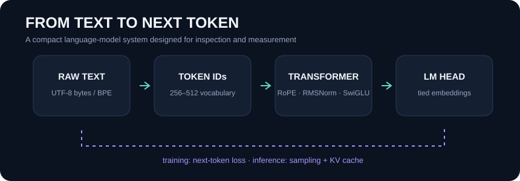
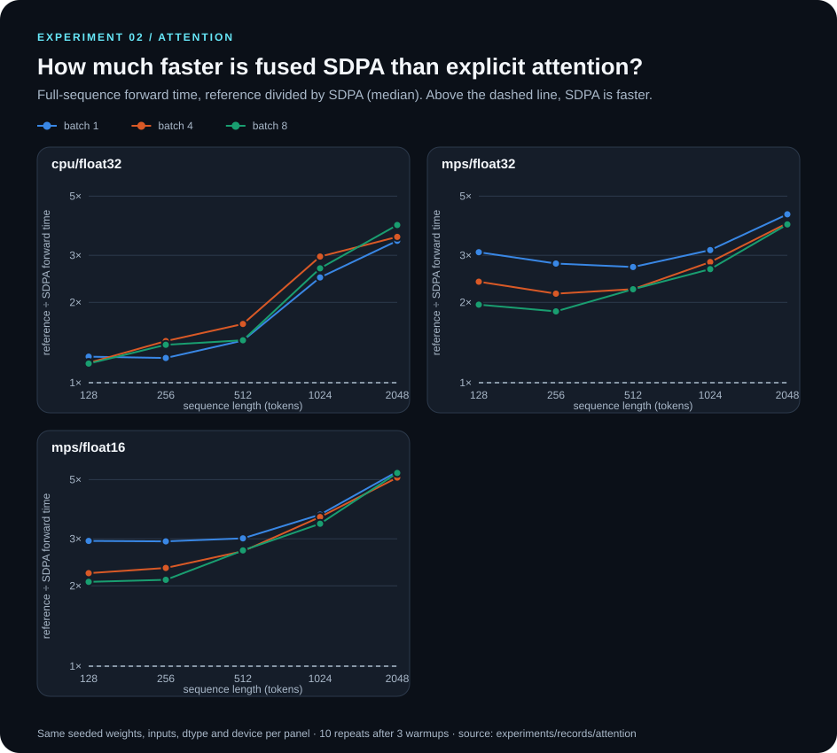
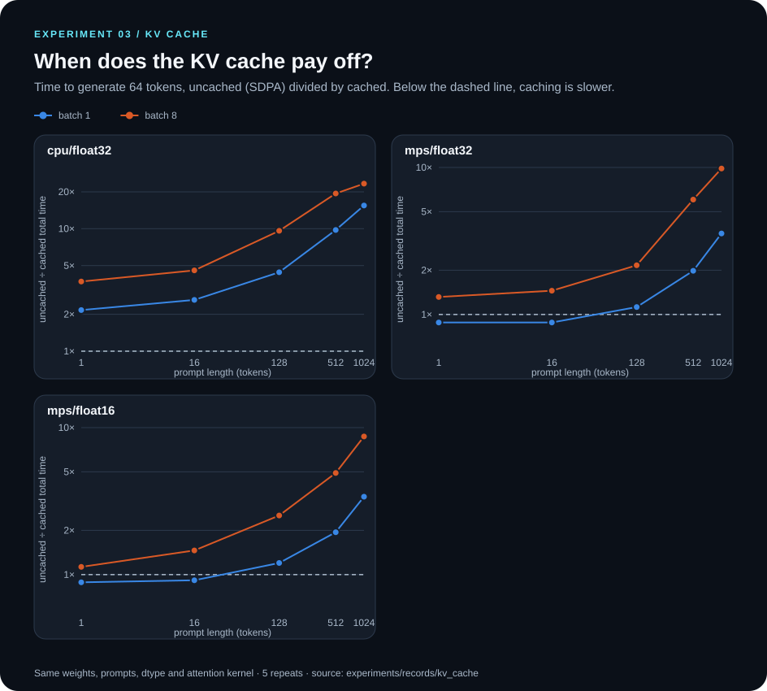

# MiniLM Lab

**Build a tiny language model. Measure what actually helps.**

Created and maintained by [Anvit Devadiga](https://github.com/AnvitDevadiga).

[](https://github.com/AnvitDevadiga/MiniLM-Lab/actions/workflows/ci.yml) [](https://www.python.org/) [](LICENSE)

## Purpose

MiniLM Lab is a small, inspectable decoder-only language model and a laboratory for measuring how implementation choices affect quality, latency, throughput and memory. It runs on a laptop and is built for controlled, reproducible comparisons, not to imitate a commercial chatbot. Every published number comes from a JSON record in [`experiments/records/`](experiments/records/).

## Implemented ML systems components

| Component | Implementation |
| --- | --- |
| Tokenization | UTF-8 byte tokenizer; educational BPE alternative |
| Decoder | causal multi-head attention, learned positions or RoPE, RMSNorm, SwiGLU, tied token/output embeddings |
| Attention backends | `sdpa` (PyTorch scaled-dot-product attention, **default**), `mha` (the original `nn.MultiheadAttention` path that produced every v1 result; legacy name `auto`), and `reference` (explicit softmax(QKᵀ/√d)V), all on the same weights |
| Training | AdamW, true optimizer-step gradient accumulation, full-split checkpoint selection, bitwise resume with optimizer and RNG state |
| Evaluation | every held-out next token scored once; perplexity and bits per byte |
| Generation | temperature, top-k, top-p; KV cache with sliding-window refresh; greedy decoding verified token-identical with and without the cache |
| Benchmarks | matched attention, KV-cache and training-step benchmarks on CPU and Apple MPS, with warmups, rotated order, device synchronization and per-process memory probes |
| Data | two corpus protocols with SHA-256 manifests and automated contamination checks |
| Reproducibility | append-only records with device, versions, git commit, seeds, data hashes and raw samples; validated by `scripts/validate_records.py` |

PyTorch provides tensor operations, autograd and the SDPA kernel. The project exposes the model and systems decisions around those primitives.



## Key results

All measurements: one Apple M4 MacBook (16 GB), CPU and MPS, Python 3.12.14, torch 2.14.1. Details and every per-seed value are in [docs/EXPERIMENT_RESULTS.md](docs/EXPERIMENT_RESULTS.md).

1. **The attention backends compute the same function, but SDPA is far cheaper at long sequences.** In float32 all three give identical held-out perplexity, 100% top-1 agreement with a float64 reference run (whose RMSNorm variance and RoPE angles are still computed in float32) and identical greedy text. At 2,048 tokens SDPA's forward pass is 3.4–3.9× (CPU) and 3.9–5.4× (MPS) faster than the explicit reference, with 8–22× less extra memory at batch 8.
2. **Training with SDPA matches the legacy path in quality and is as fast or faster.** Over three seeds on corpus v1, validation perplexity is 19.21 ± 1.75 (MHA) vs 19.04 ± 1.37 (SDPA). A controlled training-step benchmark is 5–28% faster with SDPA on CPU (L=128–1,024) and within 5% on MPS. SDPA is therefore the default from this release.
3. **The KV cache is not always a win.** It is 2.2–23× faster than recomputation on CPU, but slower on MPS for single short prompts (0.88×) and gives no benefit once generation passes the context window.
4. **Published single-seed numbers need seeds.** The original v1 run reproduces bit-for-bit on CPU, but seeds 42/43/44 give held-out perplexity 17.58 / 18.99 / 21.07; the published 17.58 is the best of three.
5. **Corpus v2 adds a held-out test book.** With non-prose text removed and Faraday's *The Chemical History of a Candle* held out, test perplexity is 15.66 ± 2.58 (MHA) and 15.60 ± 2.63 (SDPA) over three seeds. This is a different protocol from v1; the two must not be compared.





## Reproduce

Python 3.12. `requirements/release-lock.txt` pins the exact packages used for every record.

```bash
python3.12 -m venv .venv
source .venv/bin/activate
python -m pip install -r requirements/release-lock.txt
python -m pip install -e . --no-deps
make check                                   # ruff + full test suite
python scripts/validate_records.py --strict  # provenance of every record; identities verified
./scripts/verify_release.sh                  # lint, tests, strict validation, report drift
```

**Legacy v1 result (published 17.58).** v1 commands select the legacy `mha` backend explicitly. On an M4 CPU training takes about two minutes and reproduces the published run bit-for-bit with torch 2.14.

```bash
python scripts/train_tiny.py data/science/train.txt \
  --validation-text data/science/validation.txt \
  --steps 1000 --eval-interval 250 --gradient-accumulation-steps 4 \
  --device cpu --seed 42 --attention-backend mha --output-dir artifacts/runs/science-v1-s42
python scripts/evaluate.py data/science/train.txt \
  --validation-text data/science/validation.txt --device cpu --attention-backend mha \
  --checkpoint artifacts/runs/science-v1-s42/best_checkpoint.pt
```

**Experiments.**

```bash
PYTHON=python ./experiments/sdpa_v1.sh       # v1: MHA vs SDPA training, 3 seeds
PYTHON=python ./experiments/v2_protocol.sh   # v2: verify corpus, train, select on validation, test once
python scripts/benchmark_attention.py --device cpu        # also --device mps [--dtype float16]
python scripts/benchmark_kv_scaling.py --device cpu       # also --device mps [--dtype float16]
python scripts/benchmark_training_step.py --device cpu    # also --device mps
python scripts/build_experiment_report.py                 # regenerate tables and figures from records
```

Checkpoints are not committed (`artifacts/` is ignored). Each training record stores the exact command, seed, data hashes and the checkpoint file's SHA-256. A regenerated checkpoint file does **not** reproduce that file hash, because checkpoints embed elapsed seconds. Check a regenerated model with its deterministic model identity instead (`minilm_lab.identity`, scheme `minilm-model-identity/v1`). Historical identities are anchored by an [audited baseline](experiments/baselines/model_identity_baseline.json) built from the original checkpoint files and pinned by hash in code. Without the checkpoints, strict validation therefore reports them as `trusted_baseline_verified`, not artifact-verified. This is a reviewable integrity anchor, not a cryptographic signature. Example: the retrained v1 seed-42 checkpoint has a different file hash but the same model identity. Equality is only expected on the same device type and library versions; elsewhere, compare numbers within the tolerances listed in [the release checklist](docs/RELEASE_CHECKLIST.md). Record rules: [docs/RECORD_SCHEMA.md](docs/RECORD_SCHEMA.md).

The committed v1 corpus is authoritative. `python scripts/prepare_science_corpus.py --output-dir /tmp/v1` regenerates it from Project Gutenberg and refuses to write unless every split matches the published hashes. As of October 2026 it does, although the Darwin file's header has changed upstream.

## Architecture, reports and evidence

- [Architecture figure](docs/figures/architecture.svg) and model code in [`src/minilm_lab/model.py`](src/minilm_lab/model.py)
- [Experiment results: all tables, method, limitations](docs/EXPERIMENT_RESULTS.md)
- [Research report](docs/research_report.md) and [research paper (PDF, v1 only)](output/pdf/MiniLM-Lab-Research-Paper.pdf)
- [Implementation audit with evidence per claim](docs/implementation_audit.md)
- [Release checklist](docs/RELEASE_CHECKLIST.md)
- [Experiment protocol](docs/experiment_protocol.md) · [Roadmap](docs/roadmap.md) · [Contributing](CONTRIBUTING.md)
- Corpus manifests: [v1](data/science/manifest.json) · [v2](data/science-v2/manifest.json) · [published v1 record](docs/data/science_run.json)

The PDF is generated from the v1 record with `python -m pip install -e '.[report]'` and `python scripts/build_research_report.py`.

## Limitations

- **Small, under-trained models.** Every run is 1,000 optimizer steps on about 1 MB of text. On both corpora each seed spends most of the run on an early loss plateau, so quality depends strongly on the seed. Three seeds give a spread, not a confidence interval.
- **One held-out test book.** The v2 test set is a single 1861 popular-science lecture series. It measures transfer to one unseen author and topic, not broad cross-author generalization. Its results are now published, so it can no longer guide tuning under an untouched-test claim. The cleaning rules were designed while viewing its raw text (structure only, never model results).
- **Legacy v1 corpus.** 26% of v1 held-out bytes are Darwin's alphabetical index, and v1 validation both selects checkpoints and is reported. v2 fixes both; v1 is kept unchanged for comparability with the published results.
- **One machine.** Timings come from one laptop, one session per record. MPS findings apply to this tiny model, where kernel-launch overhead dominates. CUDA is untested. No cross-device or cross-version bitwise reproducibility is claimed.
- **Older artifacts.** The PDF paper and the September figures ([learning](docs/figures/learning.svg), [speed](docs/figures/speed.svg), [INT8](docs/figures/tradeoff.svg)) describe the single-seed v1 run only. The September KV-cache speedup (3.58×) re-measures at 3.40× on the same hardware, so treat it as a timing, not a constant.

Generated text should not be treated as reliable scientific information.

MIT licensed. © Anvit Devadiga.
