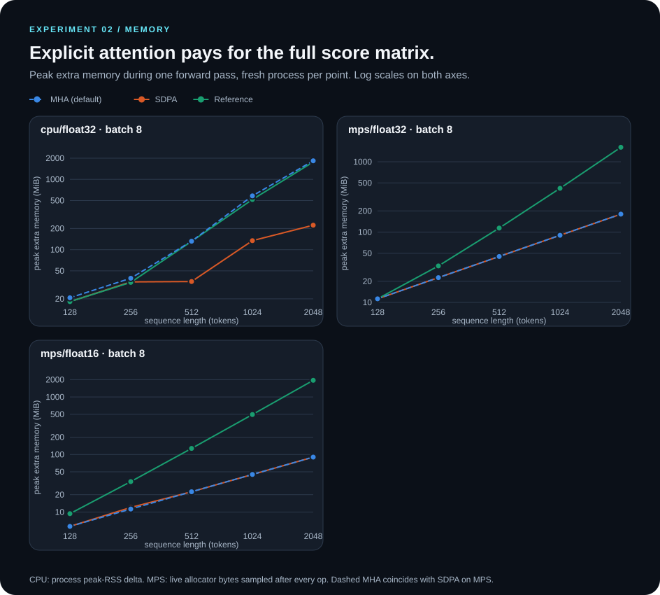
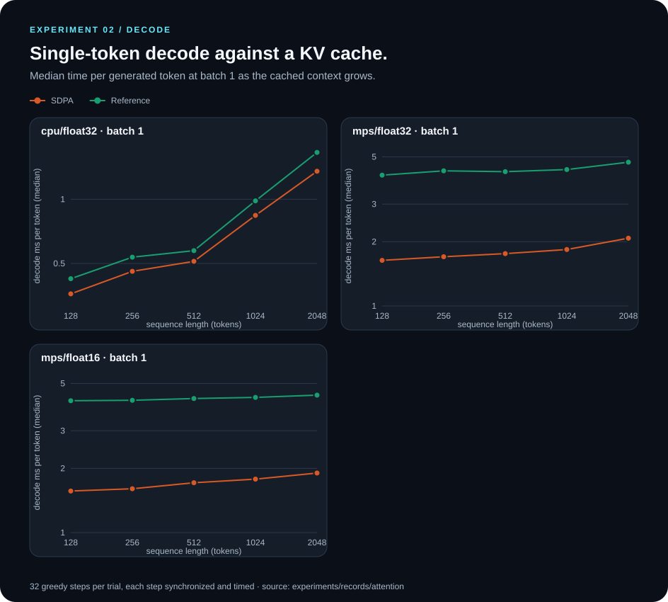

# Experiment results

Every number in a table below is generated by `scripts/build_experiment_report.py`
from JSON records in `experiments/records/`. Sections between
`BEGIN GENERATED` / `END GENERATED` markers are overwritten on rebuild; prose
outside them is hand-written and cites those tables.

## Protocols and comparability

| Protocol | Corpus | Splits | Used in |
| --- | --- | --- | --- |
| **science-v1** (legacy, unchanged) | `data/science/`: Darwin + Einstein, Gutenberg boilerplate removed, nothing else | train / validation (validation also selects checkpoints and is reported) | Part A, published September 2026 results |
| **science-v2** | `data/science-v2/`: same two books with front/back matter and non-prose removed by deterministic rules; Faraday as an untouched test book | train / validation (selection) / test (final evaluation only) | Part B |

**Perplexities are never compared across protocols.** v2 removes the Darwin index
and other non-prose text and uses a different validation set, so a lower v2 number
is not an improvement over v1. Timing experiments (02, 03 and the training-step
benchmark) use random weights and synthetic tokens and do not depend on either corpus.

Hardware for every record: one Apple M4 MacBook (16 GB), CPU with 4 torch threads
and MPS; Python 3.12.14, torch 2.14.1. No CUDA hardware was available; CUDA code
paths are untested.

## Summary

### Part A · systems experiments and science-v1

1. **The three attention implementations compute the same function.** In float32,
   default MHA, SDPA and the explicit reference give identical held-out perplexity to
   four decimals, 100% top-1 agreement with a float64 oracle and identical greedy text,
   on CPU and MPS, for three trained seeds. Gradients agree with a float64 oracle and
   pass `gradcheck` under every backend.
2. **Inference: SDPA is faster at every shape and the gap grows with length**
   (reference/SDPA forward 1.2–1.3× at L=128 → 3.4–3.9× at L=2048 on CPU; 2.0–3.1× →
   3.9–5.4× on MPS) **and avoids the L² score matrix** (B=8, L=2048: 223 vs 1,765 MiB on
   CPU fp32, 180 vs 1,608 MiB on MPS fp32, 90 vs 1,950 MiB on MPS fp16).
3. **The default MHA path is close to the reference on CPU at inference** (1,439 ms vs
   321 ms for SDPA at B=8, L=2048) and 1.1–1.6× slower than SDPA on MPS.
4. **KV cache.** On CPU the cache is faster at every measured shape: 2.2–16× over
   uncached SDPA at batch 1 and 3.8–23× at batch 8 (up to 62× over the uncached default
   path). On MPS at batch 1 with prompts of 1–16 tokens it is *slower* (0.87–0.88×);
   it pays off from 128 tokens (1.1×) and reaches 3.4× at 1,024. Past the context
   window every step rebuilds the cache, so caching gives ~1.0× on MPS. Cached and
   uncached greedy tokens are identical in every fp32 configuration; in fp16 they
   differ in 2 of 11 configurations (near-tie argmax flips with random weights).
   Cache memory grows by exactly 6,144 bytes per position per sequence (fp32), and
   each concatenating decode step transiently allocates about one full cache copy.
5. **Training with SDPA vs the default path (science-v1, 3 seeds).** Validation
   perplexity is indistinguishable: 19.21 ± 1.75 (default) vs 19.04 ± 1.37 (SDPA);
   paired differences +0.10, +0.02, −0.65. Both backends agree to seven decimals
   while the model sits on its early plateau and diverge only when it leaves it.
   In the controlled step benchmark, SDPA steps are 8% (L=128) to 28% (L=1,024)
   faster than the default on CPU with similar memory; on MPS all three backends are
   within ~5% in time and memory. CPU evaluation of the full validation split takes
   ~16% less time with SDPA (1.55 vs 1.85 s mean). Full-run tokens/s were confounded by
   run order (the first run of the session was the fastest) and are not used for claims.
6. **The published 17.58 perplexity is the best of three seeds** (17.58 / 18.99 / 21.07).

### Part B · science-v2

7. **Cleaned corpus with an untouched test book.** Darwin's index, both books' front
   matter, Einstein's symbol glossary, Faraday's notes, headings, bracketed editorial
   paragraphs and numeric tables are removed by documented rules before splitting.
   Zero exact and zero near duplicates (≥ 50% shared word 8-grams) across
   train/validation/test.
8. **Test perplexity (Faraday, never used for training or selection):
   15.66 ± 2.58 (default) and 15.60 ± 2.63 (SDPA)**, 0.1–0.4 above validation in all
   six runs. Seeds dominate the spread (13.8–18.6); the backend does not
   (paired test differences −0.10, 0.00, −0.08).

### Decision on SDPA

Correctness (forward, gradients, causality, cache equivalence) and performance are
verified. SDPA matches the default's quality on two corpora, trains as fast or faster,
evaluates faster, and is much faster with far less memory at long-sequence inference.
**Recommendation: make SDPA the default for new experiments.** It is *not* switched in
this branch, because changing the default would silently change what the published
v1 commands run; doing so should come with `--attention-backend auto` added to every
v1 reproduction command. The default (`auto`) path remains available and is bitwise
reproducible.

## Method

- **Matched comparisons.** Each timing record uses one set of seeded weights with the
  published architecture (vocab 256, width 192, 4 layers, 6 heads); only the position
  table grows to fit long sequences. `set_attention_backend` switches attention math
  without touching weights. Inputs are seeded; dtype and device are fixed per record.
- **Timing.** Warmups, then repeated trials with backend/mode order rotated each
  repeat; devices are synchronized around every timed region; decode steps are timed
  individually. Medians, p95, IQR and CV come from raw samples stored in each record.
- **Memory.** One fresh process per point. CPU: peak-RSS delta. MPS: live allocator
  bytes sampled after every aten op (forward and backward). Earlier MPS records using
  driver pool size (~1 GiB granularity) are kept but superseded.
- **Quality.** Oracle = reference backend in float64 on CPU (the softmax runs in
  float64 since the fix described in the audit). Perplexity uses the repository's
  non-overlapping 128-token chunking, with loss computed in fp32.
- **Training comparison.** Identical command, data, seeds and hardware (CPU, fp32);
  only `--attention-backend` differs; backend order alternates per seed. Default-path
  checkpoints are bitwise identical to the original v1 runs.
- **v2 protocol.** Hyperparameters are the v1 values (nothing tuned on v2). The best
  checkpoint per run is chosen on validation loss; the test book is scored once per
  selected checkpoint after all training (`experiments/v2_protocol.sh`).

## Limitations

- One laptop, one session per record; no repeat across reboots or thermal states.
- All models are trained for 1,000 steps and leave a near-unigram plateau only around
  step 750–1,000, so they are under-trained and seed-sensitive. Three seeds give a
  spread estimate, not a confidence interval.
- Latency uses random weights; quality comparisons are limited to the 128-token
  trained context.
- MPS conclusions are for a tiny model where launch overhead dominates.
- The v2 test book is a single 1861 popular-science lecture series; it measures
  transfer to one new author and topic, not general language ability.
- No CUDA, `torch.compile` or FlashAttention-specific kernels.

## Reproduce

```bash
# Inference and cache benchmarks (corpus-independent)
python scripts/benchmark_attention.py --device cpu --dtype float32
python scripts/benchmark_attention.py --device mps --dtype float32
python scripts/benchmark_attention.py --device mps --dtype float16
python scripts/benchmark_kv_scaling.py --device cpu
python scripts/benchmark_kv_scaling.py --device mps
python scripts/benchmark_kv_scaling.py --device mps --dtype float16
python scripts/benchmark_training_step.py --device cpu
python scripts/benchmark_training_step.py --device mps

# science-v1: matched default vs SDPA training, then inference quality per backend
PYTHON=python ./experiments/sdpa_v1.sh
python scripts/compare_attention_quality.py artifacts/runs/sdpa-v1/auto-s4{2,3,4}/best_checkpoint.pt

# science-v2: rebuild corpus (verified against committed files), train, select, test once
PYTHON=python ./experiments/v2_protocol.sh

python scripts/build_experiment_report.py
```

Each script writes a new timestamped record and never overwrites an existing one. The
report uses the latest record per name or device/dtype; superseded records stay on disk.







## Environment

<!-- BEGIN GENERATED:environment -->
| Record | Device | Dtype | Processor | torch | Python | Threads | Commit | Dirty |
| --- | --- | --- | --- | --- | --- | ---: | --- | --- |
| `20261022T033005Z_attention_cpu_float32_615767d.json` | cpu | float32 | Apple M4 | 2.14.1 | 3.12.14 | 4 | `615767d` | False |
| `20261022T034036Z_attention_mps_float32_0502118.json` | mps | float32 | Apple M4 | 2.14.1 | 3.12.14 | 4 | `0502118` | False |
| `20261022T034304Z_attention_mps_float16_0502118.json` | mps | float16 | Apple M4 | 2.14.1 | 3.12.14 | 4 | `0502118` | False |
| `20261022T041752Z_attention_quality_48e95f8.json` | cpu,mps | mixed | Apple M4 | 2.14.1 | 3.12.14 | 4 | `48e95f8` | False |
| `20261022T035538Z_kv_cpu_float32_93507c4.json` | cpu | float32 | Apple M4 | 2.14.1 | 3.12.14 | 4 | `93507c4` | False |
| `20261022T035808Z_kv_mps_float32_93507c4.json` | mps | float32 | Apple M4 | 2.14.1 | 3.12.14 | 4 | `93507c4` | False |
| `20261022T040019Z_kv_mps_float16_93507c4.json` | mps | float16 | Apple M4 | 2.14.1 | 3.12.14 | 4 | `93507c4` | False |
<!-- END GENERATED:environment -->

# Part A · Systems experiments and corpus science-v1 (legacy)

## Experiment 02 · Attention: reference vs PyTorch SDPA

### Forward pass latency and memory

<!-- BEGIN GENERATED:forward -->
**cpu/float32** · warmup 3, 10 repeats · median ms (p95) · peak extra MiB per forward

| B | L | MHA (default) | SDPA | Reference | Ref / SDPA | MHA MiB | SDPA MiB | Ref MiB |
| ---: | ---: | ---: | ---: | ---: | ---: | ---: | ---: | ---: |
| 1 | 128 | 1.86 (2.06) | 1.42 (2.40) | 1.78 (2.04) | 1.25× | 4.1 | 4.0 | 4.0 |
| 1 | 256 | 4.18 (4.81) | 3.00 (3.45) | 3.72 (3.84) | 1.24× | 8.9 | 5.2 | 7.3 |
| 1 | 512 | 10.49 (11.15) | 5.79 (6.23) | 8.33 (8.81) | 1.44× | 24.1 | 11.5 | 23.4 |
| 1 | 1024 | 41.98 (55.30) | 15.52 (29.28) | 38.46 (46.94) | 2.48× | 75.7 | 21.6 | 66.4 |
| 1 | 2048 | 192.72 (227.30) | 45.93 (77.64) | 156.18 (189.24) | 3.40× | 255.4 | 37.1 | 234.8 |
| 4 | 128 | 5.36 (5.94) | 4.24 (4.71) | 5.03 (5.39) | 1.19× | 11.5 | 11.4 | 11.4 |
| 4 | 256 | 20.53 (28.74) | 14.00 (18.88) | 20.06 (29.97) | 1.43× | 34.7 | 19.0 | 31.3 |
| 4 | 512 | 52.62 (54.63) | 31.23 (32.66) | 51.83 (54.97) | 1.66× | 87.3 | 35.0 | 82.2 |
| 4 | 1024 | 191.96 (203.43) | 61.17 (80.83) | 181.63 (197.34) | 2.97× | 252.5 | 37.6 | 228.5 |
| 4 | 2048 | 726.96 (1103.65) | 174.91 (301.39) | 615.28 (732.49) | 3.52× | 898.9 | 135.0 | 900.7 |
| 8 | 128 | 10.68 (11.83) | 8.69 (9.87) | 10.25 (10.74) | 1.18× | 20.7 | 18.2 | 18.2 |
| 8 | 256 | 34.89 (36.53) | 25.44 (26.03) | 35.29 (44.47) | 1.39× | 39.2 | 34.8 | 34.3 |
| 8 | 512 | 111.00 (196.13) | 68.26 (118.38) | 98.43 (227.01) | 1.44× | 131.9 | 35.2 | 131.3 |
| 8 | 1024 | 431.37 (448.51) | 140.66 (169.55) | 377.14 (466.85) | 2.68× | 582.2 | 134.2 | 517.1 |
| 8 | 2048 | 1439.33 (1525.57) | 321.03 (336.56) | 1251.08 (1522.71) | 3.90× | 1834.7 | 222.8 | 1764.6 |

**mps/float32** · warmup 3, 10 repeats · median ms (p95) · peak extra MiB per forward

| B | L | MHA (default) | SDPA | Reference | Ref / SDPA | MHA MiB | SDPA MiB | Ref MiB |
| ---: | ---: | ---: | ---: | ---: | ---: | ---: | ---: | ---: |
| 1 | 128 | 1.88 (1.98) | 1.68 (1.82) | 5.17 (5.42) | 3.08× | 1.4 | 1.4 | 1.4 |
| 1 | 256 | 2.77 (3.19) | 2.34 (2.92) | 6.53 (8.16) | 2.80× | 2.8 | 2.8 | 4.1 |
| 1 | 512 | 4.09 (4.12) | 3.51 (5.95) | 9.52 (16.60) | 2.71× | 5.6 | 5.6 | 14.6 |
| 1 | 1024 | 8.03 (8.26) | 6.17 (8.02) | 19.37 (24.79) | 3.14× | 11.3 | 11.3 | 52.8 |
| 1 | 2048 | 20.55 (23.01) | 13.02 (15.56) | 55.65 (61.46) | 4.27× | 28.0 | 22.5 | 204.0 |
| 4 | 128 | 3.76 (4.44) | 3.24 (3.34) | 7.73 (9.14) | 2.39× | 5.6 | 5.6 | 5.6 |
| 4 | 256 | 6.88 (13.39) | 5.54 (6.05) | 11.93 (13.06) | 2.15× | 11.3 | 11.3 | 16.5 |
| 4 | 512 | 12.78 (12.97) | 10.59 (11.10) | 23.73 (24.14) | 2.24× | 22.5 | 22.5 | 57.0 |
| 4 | 1024 | 28.17 (28.78) | 21.75 (22.22) | 61.56 (64.84) | 2.83× | 45.0 | 45.0 | 210.0 |
| 4 | 2048 | 71.88 (74.93) | 49.24 (53.41) | 195.01 (197.49) | 3.96× | 90.0 | 90.0 | 804.0 |
| 8 | 128 | 6.12 (6.87) | 5.37 (6.94) | 10.53 (11.89) | 1.96× | 11.3 | 11.3 | 11.3 |
| 8 | 256 | 11.86 (13.97) | 10.22 (10.79) | 18.91 (19.42) | 1.85× | 22.5 | 22.5 | 33.0 |
| 8 | 512 | 24.36 (25.03) | 20.32 (21.72) | 45.50 (50.84) | 2.24× | 45.0 | 45.0 | 114.0 |
| 8 | 1024 | 55.41 (56.97) | 43.55 (45.83) | 115.97 (117.24) | 2.66× | 90.0 | 90.0 | 420.0 |
| 8 | 2048 | 139.77 (140.99) | 98.72 (102.43) | 386.74 (396.31) | 3.92× | 180.0 | 180.0 | 1608.0 |

**mps/float16** · warmup 3, 10 repeats · median ms (p95) · peak extra MiB per forward

| B | L | MHA (default) | SDPA | Reference | Ref / SDPA | MHA MiB | SDPA MiB | Ref MiB |
| ---: | ---: | ---: | ---: | ---: | ---: | ---: | ---: | ---: |
| 1 | 128 | 2.02 (2.23) | 1.88 (2.27) | 5.54 (5.74) | 2.95× | 0.7 | 0.7 | 1.2 |
| 1 | 256 | 2.58 (2.88) | 2.21 (2.41) | 6.48 (6.92) | 2.94× | 1.4 | 1.4 | 4.2 |
| 1 | 512 | 3.96 (4.67) | 3.28 (3.62) | 9.89 (11.19) | 3.01× | 2.8 | 2.8 | 15.9 |
| 1 | 1024 | 7.27 (7.82) | 5.60 (6.33) | 20.70 (20.90) | 3.70× | 6.1 | 5.6 | 61.9 |
| 1 | 2048 | 17.45 (17.55) | 11.23 (11.40) | 60.15 (64.73) | 5.36× | 14.0 | 12.0 | 243.8 |
| 4 | 128 | 3.64 (5.11) | 3.24 (3.95) | 7.23 (8.94) | 2.23× | 2.8 | 2.8 | 4.7 |
| 4 | 256 | 5.75 (5.99) | 5.04 (5.99) | 11.77 (12.29) | 2.33× | 5.6 | 5.6 | 16.9 |
| 4 | 512 | 10.65 (12.21) | 8.97 (9.03) | 24.18 (26.01) | 2.70× | 11.3 | 12.0 | 63.8 |
| 4 | 1024 | 23.85 (24.58) | 18.68 (19.80) | 67.64 (71.91) | 3.62× | 23.0 | 22.5 | 247.5 |
| 4 | 2048 | 60.74 (62.22) | 42.51 (49.76) | 216.36 (221.87) | 5.09× | 45.0 | 45.0 | 975.0 |
| 8 | 128 | 5.63 (7.31) | 4.91 (6.26) | 10.16 (10.56) | 2.07× | 5.6 | 5.6 | 9.4 |
| 8 | 256 | 9.84 (12.22) | 8.76 (9.09) | 18.46 (18.86) | 2.11× | 11.3 | 12.0 | 33.8 |
| 8 | 512 | 21.83 (27.02) | 18.96 (23.19) | 51.48 (58.01) | 2.71× | 22.5 | 22.5 | 127.5 |
| 8 | 1024 | 46.50 (47.40) | 36.64 (39.90) | 125.23 (129.83) | 3.42× | 45.0 | 45.0 | 495.0 |
| 8 | 2048 | 118.43 (121.10) | 83.26 (88.71) | 440.90 (458.74) | 5.30× | 90.0 | 90.0 | 1950.0 |
<!-- END GENERATED:forward -->

### Prefill, decode and generation throughput

<!-- BEGIN GENERATED:decode -->
**cpu/float32** · 32 greedy decode steps after an L-token prefill · median (p95)

| B | L | SDPA prefill ms | Ref prefill ms | SDPA decode ms/step | Ref decode ms/step | SDPA gen tok/s | Ref gen tok/s |
| ---: | ---: | ---: | ---: | ---: | ---: | ---: | ---: |
| 1 | 128 | 1.44 (1.98) | 1.78 (2.15) | 0.36 (0.45) | 0.42 (0.47) | 2443 | 2058 |
| 1 | 256 | 2.99 (3.47) | 3.59 (3.91) | 0.46 (0.53) | 0.54 (0.62) | 1773 | 1537 |
| 1 | 512 | 5.75 (6.07) | 8.36 (8.65) | 0.51 (0.63) | 0.57 (0.69) | 1415 | 1190 |
| 1 | 1024 | 15.65 (19.65) | 38.94 (50.15) | 0.84 (1.04) | 0.98 (1.26) | 730 | 453 |
| 1 | 2048 | 45.73 (80.18) | 147.24 (176.31) | 1.35 (2.88) | 1.66 (2.43) | 358 | 160 |
| 4 | 128 | 4.30 (4.92) | 5.07 (5.43) | 0.74 (0.91) | 0.97 (1.10) | 4436 | 3467 |
| 4 | 256 | 12.93 (28.47) | 19.27 (37.01) | 1.24 (2.20) | 1.66 (2.31) | 2387 | 1696 |
| 4 | 512 | 32.20 (33.98) | 52.16 (55.70) | 1.42 (1.67) | 1.83 (2.15) | 1640 | 1151 |
| 4 | 1024 | 60.95 (77.18) | 155.43 (181.36) | 1.89 (2.59) | 2.83 (3.73) | 1037 | 511 |
| 4 | 2048 | 175.27 (288.85) | 576.90 (635.33) | 3.47 (9.16) | 5.74 (7.29) | 450 | 165 |
| 8 | 128 | 8.80 (10.38) | 10.36 (11.45) | 1.05 (1.22) | 1.45 (1.62) | 5930 | 4453 |
| 8 | 256 | 25.86 (26.94) | 35.85 (38.53) | 1.47 (1.68) | 1.99 (2.31) | 3464 | 2564 |
| 8 | 512 | 61.36 (96.22) | 102.72 (201.61) | 2.13 (3.36) | 3.20 (8.11) | 1957 | 1256 |
| 8 | 1024 | 150.42 (171.68) | 345.12 (433.23) | 3.59 (5.13) | 6.16 (8.85) | 947 | 450 |
| 8 | 2048 | 360.67 (441.24) | 1263.21 (1348.73) | 7.71 (10.18) | 10.57 (13.46) | 430 | 158 |

**mps/float32** · 32 greedy decode steps after an L-token prefill · median (p95)

| B | L | SDPA prefill ms | Ref prefill ms | SDPA decode ms/step | Ref decode ms/step | SDPA gen tok/s | Ref gen tok/s |
| ---: | ---: | ---: | ---: | ---: | ---: | ---: | ---: |
| 1 | 128 | 1.67 (2.31) | 2.21 (2.46) | 1.64 (1.79) | 4.10 (4.99) | 587 | 237 |
| 1 | 256 | 2.28 (2.50) | 3.43 (3.99) | 1.70 (2.80) | 4.30 (5.23) | 555 | 223 |
| 1 | 512 | 3.53 (5.77) | 5.86 (7.84) | 1.76 (1.93) | 4.26 (4.79) | 530 | 225 |
| 1 | 1024 | 6.17 (7.43) | 16.25 (19.09) | 1.84 (2.13) | 4.36 (5.11) | 486 | 203 |
| 1 | 2048 | 13.07 (14.32) | 52.20 (55.90) | 2.08 (3.26) | 4.72 (6.22) | 392 | 155 |
| 4 | 128 | 3.31 (4.71) | 4.33 (4.54) | 1.91 (2.86) | 4.37 (4.97) | 1968 | 883 |
| 4 | 256 | 5.61 (6.35) | 8.96 (10.08) | 2.07 (2.81) | 4.74 (6.54) | 1771 | 804 |
| 4 | 512 | 10.57 (10.76) | 20.36 (20.64) | 2.34 (2.48) | 4.81 (5.28) | 1495 | 729 |
| 4 | 1024 | 21.51 (22.44) | 59.15 (61.19) | 2.79 (4.02) | 5.53 (9.26) | 1177 | 505 |
| 4 | 2048 | 49.23 (53.32) | 193.99 (197.43) | 4.19 (6.50) | 7.02 (11.78) | 715 | 287 |
| 8 | 128 | 5.36 (6.36) | 7.19 (7.35) | 2.18 (2.45) | 4.68 (5.19) | 3382 | 1619 |
| 8 | 256 | 10.31 (11.25) | 15.86 (16.26) | 2.49 (2.68) | 4.96 (5.63) | 2822 | 1444 |
| 8 | 512 | 20.33 (22.47) | 40.45 (43.12) | 3.08 (4.80) | 5.66 (8.66) | 2197 | 1065 |
| 8 | 1024 | 42.99 (46.05) | 113.80 (115.24) | 4.58 (6.74) | 7.26 (14.64) | 1363 | 675 |
| 8 | 2048 | 97.37 (102.13) | 383.13 (399.19) | 6.47 (8.87) | 9.62 (14.22) | 836 | 356 |

**mps/float16** · 32 greedy decode steps after an L-token prefill · median (p95)

| B | L | SDPA prefill ms | Ref prefill ms | SDPA decode ms/step | Ref decode ms/step | SDPA gen tok/s | Ref gen tok/s |
| ---: | ---: | ---: | ---: | ---: | ---: | ---: | ---: |
| 1 | 128 | 1.82 (2.06) | 2.33 (2.62) | 1.57 (1.84) | 4.15 (4.58) | 602 | 237 |
| 1 | 256 | 2.23 (2.36) | 3.25 (3.43) | 1.61 (1.92) | 4.17 (4.81) | 588 | 233 |
| 1 | 512 | 3.28 (3.76) | 6.42 (7.30) | 1.71 (1.86) | 4.25 (4.68) | 550 | 223 |
| 1 | 1024 | 5.60 (6.02) | 17.49 (18.14) | 1.78 (1.97) | 4.30 (4.84) | 510 | 205 |
| 1 | 2048 | 11.20 (11.26) | 57.02 (58.05) | 1.90 (2.25) | 4.41 (5.38) | 442 | 160 |
| 4 | 128 | 3.11 (3.62) | 4.30 (4.87) | 1.86 (2.03) | 4.36 (4.92) | 2031 | 880 |
| 4 | 256 | 5.04 (5.53) | 8.37 (8.78) | 1.99 (2.14) | 4.50 (5.11) | 1854 | 837 |
| 4 | 512 | 9.02 (9.13) | 20.87 (21.49) | 2.28 (2.48) | 4.75 (5.40) | 1556 | 727 |
| 4 | 1024 | 18.73 (20.24) | 63.57 (65.75) | 2.67 (5.06) | 5.23 (7.07) | 1254 | 541 |
| 4 | 2048 | 42.40 (45.02) | 214.22 (216.86) | 3.50 (5.57) | 6.63 (11.13) | 809 | 281 |
| 8 | 128 | 4.98 (5.90) | 6.99 (7.46) | 2.02 (2.14) | 4.49 (5.03) | 3658 | 1672 |
| 8 | 256 | 8.72 (8.98) | 15.25 (15.68) | 2.36 (2.65) | 4.82 (5.32) | 3032 | 1498 |
| 8 | 512 | 18.98 (21.46) | 44.86 (56.61) | 2.90 (4.86) | 5.60 (8.95) | 2193 | 1079 |
| 8 | 1024 | 36.92 (40.58) | 124.45 (128.06) | 3.90 (6.53) | 6.71 (10.62) | 1631 | 708 |
| 8 | 2048 | 84.88 (87.50) | 430.49 (446.11) | 6.06 (8.56) | 9.05 (15.89) | 923 | 343 |
<!-- END GENERATED:decode -->

### Timing variability

<!-- BEGIN GENERATED:variability -->
| Target | Phase | Median CV | Worst CV | Worst config |
| --- | --- | ---: | ---: | --- |
| cpu/float32 | forward_ms | 0.074 | 0.493 | reference B=8 L=512 |
| cpu/float32 | prefill_ms | 0.099 | 0.537 | sdpa B=4 L=256 |
| cpu/float32 | decode_ms_per_step | 0.130 | 0.935 | reference B=8 L=1024 |
| mps/float32 | forward_ms | 0.040 | 0.454 | auto B=4 L=256 |
| mps/float32 | prefill_ms | 0.040 | 0.266 | sdpa B=1 L=512 |
| mps/float32 | decode_ms_per_step | 0.182 | 0.474 | reference B=4 L=256 |
| mps/float16 | forward_ms | 0.048 | 0.165 | auto B=4 L=128 |
| mps/float16 | prefill_ms | 0.033 | 0.139 | reference B=8 L=512 |
| mps/float16 | decode_ms_per_step | 0.166 | 0.339 | reference B=8 L=1024 |
<!-- END GENERATED:variability -->

### Numerical correctness and output quality (trained checkpoints)

<!-- BEGIN GENERATED:quality -->
Oracle: cpu float64, reference backend; 112,111 held-out targets; greedy: 8 prompts × 64 tokens.

| Seed | Target | Backend | max abs Δlogit | mean abs Δlogit | top-1 agree | Perplexity | Greedy identical |
| ---: | --- | --- | ---: | ---: | ---: | ---: | ---: |
| 42 | cpu/float32 | MHA (default) | 3.60e-05 | 1.04e-06 | 100.000% | 17.5827 | 8/8 |
| 42 | cpu/float32 | SDPA | 3.40e-05 | 1.04e-06 | 100.000% | 17.5827 | 8/8 |
| 42 | cpu/float32 | Reference | 3.71e-05 | 1.04e-06 | 100.000% | 17.5827 | 8/8 |
| 42 | mps/float32 | MHA (default) | 3.31e-05 | 1.03e-06 | 100.000% | 17.5827 | 8/8 |
| 42 | mps/float32 | SDPA | 3.31e-05 | 1.03e-06 | 100.000% | 17.5827 | 8/8 |
| 42 | mps/float32 | Reference | 4.16e-05 | 1.03e-06 | 100.000% | 17.5827 | 8/8 |
| 42 | mps/float16 | MHA (default) | 7.36e-02 | 2.18e-03 | 99.880% | 17.5826 | 6/8 |
| 42 | mps/float16 | SDPA | 7.36e-02 | 2.18e-03 | 99.880% | 17.5826 | 6/8 |
| 42 | mps/float16 | Reference | 8.14e-02 | 2.19e-03 | 99.880% | 17.5825 | 6/8 |
| 42 | mps/bfloat16 | MHA (default) | 6.00e-01 | 1.75e-02 | 98.786% | 17.5863 | 4/8 |
| 42 | mps/bfloat16 | SDPA | 6.00e-01 | 1.75e-02 | 98.786% | 17.5863 | 4/8 |
| 42 | mps/bfloat16 | Reference | 6.00e-01 | 1.75e-02 | 98.755% | 17.5858 | 3/8 |
| 43 | cpu/float32 | MHA (default) | 1.82e-05 | 7.85e-07 | 100.000% | 18.9894 | 8/8 |
| 43 | cpu/float32 | SDPA | 1.70e-05 | 7.86e-07 | 100.000% | 18.9894 | 8/8 |
| 43 | cpu/float32 | Reference | 2.00e-05 | 7.87e-07 | 100.000% | 18.9894 | 8/8 |
| 43 | mps/float32 | MHA (default) | 1.60e-05 | 7.80e-07 | 100.000% | 18.9894 | 8/8 |
| 43 | mps/float32 | SDPA | 1.60e-05 | 7.80e-07 | 100.000% | 18.9894 | 8/8 |
| 43 | mps/float32 | Reference | 1.84e-05 | 7.80e-07 | 100.000% | 18.9894 | 8/8 |
| 43 | mps/float16 | MHA (default) | 4.85e-02 | 1.78e-03 | 99.851% | 18.9889 | 6/8 |
| 43 | mps/float16 | SDPA | 4.85e-02 | 1.78e-03 | 99.851% | 18.9889 | 6/8 |
| 43 | mps/float16 | Reference | 4.85e-02 | 1.78e-03 | 99.855% | 18.9888 | 6/8 |
| 43 | mps/bfloat16 | MHA (default) | 4.58e-01 | 1.43e-02 | 98.708% | 18.9908 | 3/8 |
| 43 | mps/bfloat16 | SDPA | 4.58e-01 | 1.43e-02 | 98.708% | 18.9908 | 3/8 |
| 43 | mps/bfloat16 | Reference | 4.29e-01 | 1.43e-02 | 98.701% | 18.9894 | 4/8 |
| 44 | cpu/float32 | MHA (default) | 1.22e-05 | 7.66e-07 | 100.000% | 21.0677 | 8/8 |
| 44 | cpu/float32 | SDPA | 9.53e-06 | 7.67e-07 | 100.000% | 21.0677 | 8/8 |
| 44 | cpu/float32 | Reference | 9.77e-06 | 7.67e-07 | 100.000% | 21.0677 | 8/8 |
| 44 | mps/float32 | MHA (default) | 1.19e-05 | 7.67e-07 | 100.000% | 21.0677 | 8/8 |
| 44 | mps/float32 | SDPA | 1.19e-05 | 7.67e-07 | 100.000% | 21.0677 | 8/8 |
| 44 | mps/float32 | Reference | 1.24e-05 | 7.67e-07 | 100.000% | 21.0677 | 8/8 |
| 44 | mps/float16 | MHA (default) | 3.33e-02 | 1.56e-03 | 99.804% | 21.0675 | 8/8 |
| 44 | mps/float16 | SDPA | 3.33e-02 | 1.56e-03 | 99.804% | 21.0675 | 8/8 |
| 44 | mps/float16 | Reference | 3.33e-02 | 1.57e-03 | 99.802% | 21.0674 | 7/8 |
| 44 | mps/bfloat16 | MHA (default) | 2.88e-01 | 1.24e-02 | 98.422% | 21.0724 | 5/8 |
| 44 | mps/bfloat16 | SDPA | 2.88e-01 | 1.24e-02 | 98.422% | 21.0724 | 5/8 |
| 44 | mps/bfloat16 | Reference | 2.75e-01 | 1.24e-02 | 98.416% | 21.0718 | 6/8 |
<!-- END GENERATED:quality -->

## Seed variability of the published configuration (science-v1)

<!-- BEGIN GENERATED:seeds -->
| Seed | Held-out perplexity | Bits per byte |
| ---: | ---: | ---: |
| 42 | 17.583 | 4.1361 |
| 43 | 18.989 | 4.2471 |
| 44 | 21.068 | 4.3970 |
| **mean ± sd (n=3)** | **19.213 ± 1.753** | |
<!-- END GENERATED:seeds -->

## Experiment 03 · KV cache: cached vs uncached decoding (corpus-independent)

<!-- BEGIN GENERATED:kv -->
**cpu/float32** · 64 greedy tokens · median total ms over 5 repeats · step 0 is the prefill

| B | Prompt | Cached | Uncached (SDPA) | Uncached (default) | Cache speedup vs SDPA | vs default | Cached decode ms/step | Tokens identical |
| ---: | ---: | ---: | ---: | ---: | ---: | ---: | ---: | :---: |
| 1 | 1 | 21.1 | 46.2 | 52.0 | 2.19× | 2.46× | 0.32 | yes |
| 1 | 16 | 21.7 | 55.9 | 65.3 | 2.58× | 3.02× | 0.33 | yes |
| 1 | 128 | 26.6 | 117.4 | 153.1 | 4.41× | 5.74× | 0.38 | yes |
| 1 | 512 | 39.2 | 392.8 | 744.5 | 10.02× | 18.99× | 0.52 | yes |
| 1 | 1024 | 64.1 | 1025.6 | 2449.9 | 15.99× | 38.20× | 0.78 | yes |
| 8 | 1 | 38.7 | 145.2 | 168.7 | 3.75× | 4.36× | 0.61 | yes |
| 8 | 16 | 42.9 | 192.9 | 225.9 | 4.50× | 5.27× | 0.65 | yes |
| 8 | 128 | 73.1 | 664.4 | 852.5 | 9.09× | 11.67× | 0.99 | yes |
| 8 | 512 | 159.2 | 3143.2 | 6026.2 | 19.74× | 37.85× | 1.69 | yes |
| 8 | 1024 | 399.2 | 9256.2 | 24852.5 | 23.19× | 62.26× | 4.38 | yes |

Past the window (context 128, prompt 32, 224 tokens): 128 of 224 cached steps rebuild the cache; cached 237.9 ms vs uncached SDPA 328.5 ms (1.38×); tokens identical: yes.

**mps/float32** · 64 greedy tokens · median total ms over 5 repeats · step 0 is the prefill

| B | Prompt | Cached | Uncached (SDPA) | Uncached (default) | Cache speedup vs SDPA | vs default | Cached decode ms/step | Tokens identical |
| ---: | ---: | ---: | ---: | ---: | ---: | ---: | ---: | :---: |
| 1 | 1 | 106.7 | 94.1 | 101.2 | 0.88× | 0.95× | 1.68 | yes |
| 1 | 16 | 108.7 | 95.0 | 102.1 | 0.87× | 0.94× | 1.70 | yes |
| 1 | 128 | 110.1 | 124.2 | 133.4 | 1.13× | 1.21× | 1.72 | yes |
| 1 | 512 | 126.1 | 252.6 | 301.0 | 2.00× | 2.39× | 1.81 | yes |
| 1 | 1024 | 160.1 | 547.5 | 985.8 | 3.42× | 6.16× | 2.44 | yes |
| 8 | 1 | 127.2 | 156.3 | 174.4 | 1.23× | 1.37× | 1.97 | yes |
| 8 | 16 | 136.7 | 205.7 | 234.1 | 1.50× | 1.71× | 2.12 | yes |
| 8 | 128 | 255.4 | 542.7 | 677.8 | 2.12× | 2.65× | 3.75 | yes |
| 8 | 512 | 338.6 | 2115.3 | 2672.6 | 6.25× | 7.89× | 4.50 | yes |
| 8 | 1024 | 475.1 | 4506.9 | 5765.1 | 9.49× | 12.13× | 6.38 | yes |

Past the window (context 128, prompt 32, 224 tokens): 128 of 224 cached steps rebuild the cache; cached 399.2 ms vs uncached SDPA 403.6 ms (1.01×); tokens identical: yes.

**mps/float16** · 64 greedy tokens · median total ms over 5 repeats · step 0 is the prefill

| B | Prompt | Cached | Uncached (SDPA) | Uncached (default) | Cache speedup vs SDPA | vs default | Cached decode ms/step | Tokens identical |
| ---: | ---: | ---: | ---: | ---: | ---: | ---: | ---: | :---: |
| 1 | 1 | 101.0 | 89.8 | 97.2 | 0.89× | 0.96× | 1.56 | yes |
| 1 | 16 | 102.0 | 94.7 | 100.7 | 0.93× | 0.99× | 1.58 | yes |
| 1 | 128 | 102.7 | 122.7 | 131.1 | 1.19× | 1.28× | 1.57 | **no** |
| 1 | 512 | 120.5 | 231.1 | 266.2 | 1.92× | 2.21× | 1.77 | yes |
| 1 | 1024 | 153.6 | 505.1 | 591.2 | 3.29× | 3.85× | 2.27 | yes |
| 8 | 1 | 118.4 | 151.0 | 166.5 | 1.28× | 1.41× | 1.86 | **no** |
| 8 | 16 | 125.7 | 184.1 | 213.8 | 1.46× | 1.70× | 1.97 | yes |
| 8 | 128 | 194.4 | 461.4 | 516.9 | 2.37× | 2.66× | 2.97 | yes |
| 8 | 512 | 314.1 | 1698.3 | 2062.4 | 5.41× | 6.57× | 4.17 | yes |
| 8 | 1024 | 405.2 | 3712.9 | 4647.8 | 9.16× | 11.47× | 5.18 | yes |

Past the window (context 128, prompt 32, 224 tokens): 128 of 224 cached steps rebuild the cache; cached 380.1 ms vs uncached SDPA 377.6 ms (0.99×); tokens identical: yes.
<!-- END GENERATED:kv -->

### Cache memory growth

<!-- BEGIN GENERATED:kv_memory -->
| Target | B | Cached positions | Cache bytes | Bytes per position per sequence | Live-allocator peak during step (MPS) |
| --- | ---: | ---: | ---: | ---: | ---: |
| cpu/float32 | 1 | 129 | 0.76 MiB | 6144 | – |
| cpu/float32 | 1 | 191 | 1.12 MiB | 6144 | – |
| cpu/float32 | 8 | 129 | 6.05 MiB | 6144 | – |
| cpu/float32 | 8 | 191 | 8.95 MiB | 6144 | – |
| mps/float32 | 1 | 129 | 0.76 MiB | 6144 | 0.77 MiB |
| mps/float32 | 1 | 191 | 1.12 MiB | 6144 | 1.13 MiB |
| mps/float32 | 8 | 129 | 6.05 MiB | 6144 | 6.14 MiB |
| mps/float32 | 8 | 191 | 8.95 MiB | 6144 | 11.44 MiB |
| mps/float16 | 1 | 129 | 0.38 MiB | 3072 | 0.39 MiB |
| mps/float16 | 1 | 191 | 0.56 MiB | 3072 | 0.57 MiB |
| mps/float16 | 8 | 129 | 3.02 MiB | 3072 | 3.07 MiB |
| mps/float16 | 8 | 191 | 4.48 MiB | 3072 | 4.52 MiB |
<!-- END GENERATED:kv_memory -->

## Experiment 04 · Matched training: default attention vs SDPA (science-v1 corpus)

### Controlled training-step benchmark

<!-- BEGIN GENERATED:training_step -->
**cpu/float32** · batch 8 · forward + backward + AdamW · 10 repeats after 3 warmups · median (p95)

| L | Backend | Step ms | Tokens/s | First-step extra memory MiB | max abs loss difference vs default |
| ---: | --- | ---: | ---: | ---: | ---: |
| 128 | MHA (default) | 27.8 (28.5) | 36867 | 107.8 | 0.0e+00 |
| 128 | SDPA | 25.6 (27.1) | 39931 | 105.7 | 4.8e-07 |
| 128 | Reference | 27.7 (29.2) | 37029 | 119.5 | 4.8e-07 |
| 256 | MHA (default) | 54.6 (55.8) | 37542 | 211.1 | 0.0e+00 |
| 256 | SDPA | 51.9 (52.7) | 39476 | 206.9 | 0.0e+00 |
| 256 | Reference | 60.9 (61.9) | 33613 | 283.7 | 0.0e+00 |
| 512 | MHA (default) | 132.0 (135.1) | 31034 | 415.0 | 0.0e+00 |
| 512 | SDPA | 122.0 (134.0) | 33588 | 405.8 | 4.8e-07 |
| 512 | Reference | 168.2 (170.2) | 24356 | 684.1 | 9.5e-07 |
| 1024 | MHA (default) | 353.1 (367.3) | 23200 | 800.7 | 0.0e+00 |
| 1024 | SDPA | 276.1 (288.4) | 29670 | 768.2 | 4.8e-07 |
| 1024 | Reference | 531.4 (543.8) | 15416 | 1918.8 | 4.8e-07 |

**mps/float32** · batch 8 · forward + backward + AdamW · 10 repeats after 3 warmups · median (p95)

| L | Backend | Step ms | Tokens/s | First-step extra memory MiB | max abs loss difference vs default |
| ---: | --- | ---: | ---: | ---: | ---: |
| 128 | MHA (default) | 26.6 (27.0) | 38498 | 105.0 | 0.0e+00 |
| 128 | SDPA | 25.6 (25.9) | 39940 | 98.5 | 4.8e-07 |
| 128 | Reference | 25.1 (25.4) | 40733 | 98.6 | 4.8e-07 |
| 256 | MHA (default) | 51.9 (57.9) | 39498 | 232.3 | 0.0e+00 |
| 256 | SDPA | 49.8 (55.7) | 41119 | 220.8 | 0.0e+00 |
| 256 | Reference | 50.3 (51.8) | 40717 | 221.1 | 0.0e+00 |
| 512 | MHA (default) | 117.3 (117.7) | 34915 | 567.1 | 0.0e+00 |
| 512 | SDPA | 112.3 (115.7) | 36487 | 549.1 | 4.8e-07 |
| 512 | Reference | 115.3 (124.4) | 35520 | 550.1 | 4.8e-07 |
| 1024 | MHA (default) | 306.5 (308.2) | 26732 | 1708.3 | 0.0e+00 |
| 1024 | SDPA | 296.8 (298.8) | 27604 | 1672.3 | 4.8e-07 |
| 1024 | Reference | 309.9 (311.9) | 26432 | 1676.3 | 0.0e+00 |
<!-- END GENERATED:training_step -->

### Full training runs (1,000 steps, 3 seeds, CPU)

<!-- BEGIN GENERATED:sdpa_training -->
| Seed | Backend | Selected step | Val loss | Val perplexity | Train tok/s | Train s | Peak RSS MiB | Eval s (CPU) | Eval s (MPS) |
| ---: | --- | ---: | ---: | ---: | ---: | ---: | ---: | ---: | ---: |
| 42 | MHA (default) | 1000 | 2.8669 | 17.583 | 36842 | 111.2 | 444 | 1.71 | 2.34 |
| 42 | SDPA | 1000 | 2.8726 | 17.683 | 30232 | 135.5 | 448 | 1.53 | 2.15 |
| 43 | MHA (default) | 1000 | 2.9439 | 18.989 | 29278 | 139.9 | 449 | 1.93 | 2.12 |
| 43 | SDPA | 1000 | 2.9449 | 19.009 | 31231 | 131.2 | 445 | 1.57 | 2.11 |
| 44 | MHA (default) | 1000 | 3.0477 | 21.068 | 28831 | 142.1 | 451 | 1.90 | 2.17 |
| 44 | SDPA | 1000 | 3.0163 | 20.416 | 31579 | 129.7 | 442 | 1.56 | 2.21 |

| Backend | n | Val perplexity mean ± sd | Train tok/s mean ± sd | Peak RSS MiB mean ± sd | CPU eval s mean ± sd |
| --- | ---: | ---: | ---: | ---: | ---: |
| MHA (default) | 3 | 19.213 ± 1.753 | 31650.275 ± 4501.336 | 447.990 ± 3.342 | 1.847 ± 0.118 |
| SDPA | 3 | 19.036 ± 1.366 | 31013.909 ± 698.998 | 445.031 ± 3.414 | 1.550 ± 0.020 |

| Seed | SDPA − default val perplexity | SDPA / default train tok/s |
| ---: | ---: | ---: |
| 42 | +0.101 | 0.821× |
| 43 | +0.020 | 1.067× |
| 44 | -0.652 | 1.095× |
<!-- END GENERATED:sdpa_training -->

# Part B · Corpus protocol science-v2

Results in this part use a different corpus and preprocessing protocol from Part A.
**Perplexities are not comparable across the two parts.**

## Corpus science-v2

<!-- BEGIN GENERATED:v2_corpus -->
| Source | Role | Body SHA-256 | Main-text paragraphs | Dropped (rule: count) | Kept | Train paragraphs |
| --- | --- | --- | ---: | --- | ---: | ---: |
| On the Origin of Species (1859) (Charles Darwin) | train_validation | `9ff49617f2a0…` | 711 | no_lowercase_heading: 15 | 696 | 623 |
| Relativity: The Special and General Theory (Lawson translation) (Albert Einstein) | train_validation | `384e707c77e5…` | 542 | no_lowercase_heading: 79 | 463 | 404 |
| The Chemical History of a Candle (Michael Faraday) | test | `5580d9bfa409…` | 217 | bracketed_editorial: 40, no_lowercase_heading: 15, numeric_list_or_table: 2 | 160 | – |

| File | Bytes | SHA-256 |
| --- | ---: | --- |
| `train.txt` | 969,506 | `65182db3ac268ec9…` |
| `validation.txt` | 105,666 | `6457fe8eaf9011ef…` |
| `test.txt` | 211,849 | `9e98ba26c3517318…` |
| `darwin-1859-validation.txt` | 87,711 | `dea22adfd1f580ec…` |
| `einstein-1924-validation.txt` | 17,953 | `c6728bc6890bc714…` |

| Check | Paragraphs | Exact duplicates | Near duplicates (≥50% word 8-grams) | Mean 8-gram overlap |
| --- | ---: | ---: | ---: | ---: |
| darwin-1859_validation_vs_train | 73 | 0 | 0 | 0.00624 |
| einstein-1924_validation_vs_train | 59 | 0 | 0 | 0.00976 |
| test_vs_train | 160 | 0 | 0 | 0.00002 |
| test_vs_validation | 160 | 0 | 0 | 0.00002 |
<!-- END GENERATED:v2_corpus -->

## Results under science-v2

<!-- BEGIN GENERATED:v2_results -->
| Seed | Backend | Selected step (on validation) | Val perplexity | Val bits/byte | **Test perplexity** | **Test bits/byte** | Darwin val ppl | Einstein val ppl |
| ---: | --- | ---: | ---: | ---: | ---: | ---: | ---: | ---: |
| 42 | MHA (default) | 1000 | 14.241 | 3.8319 | **14.472** | **3.8552** | 13.903 | 16.015 |
| 42 | SDPA | 1000 | 14.140 | 3.8217 | **14.372** | **3.8451** | 13.802 | 15.908 |
| 43 | MHA (default) | 1000 | 18.497 | 4.2092 | **18.623** | **4.2190** | 18.009 | 21.065 |
| 43 | SDPA | 1000 | 18.497 | 4.2092 | **18.623** | **4.2190** | 18.009 | 21.065 |
| 44 | MHA (default) | 1000 | 13.501 | 3.7550 | **13.886** | **3.7955** | 13.151 | 15.316 |
| 44 | SDPA | 1000 | 13.482 | 3.7530 | **13.802** | **3.7868** | 13.134 | 15.286 |

| Backend | n | Val perplexity mean ± sd | Test perplexity mean ± sd |
| --- | ---: | ---: | ---: |
| MHA (default) | 3 | 15.413 ± 2.697 | 15.660 ± 2.583 |
| SDPA | 3 | 15.373 ± 2.726 | 15.599 ± 2.634 |
<!-- END GENERATED:v2_results -->
